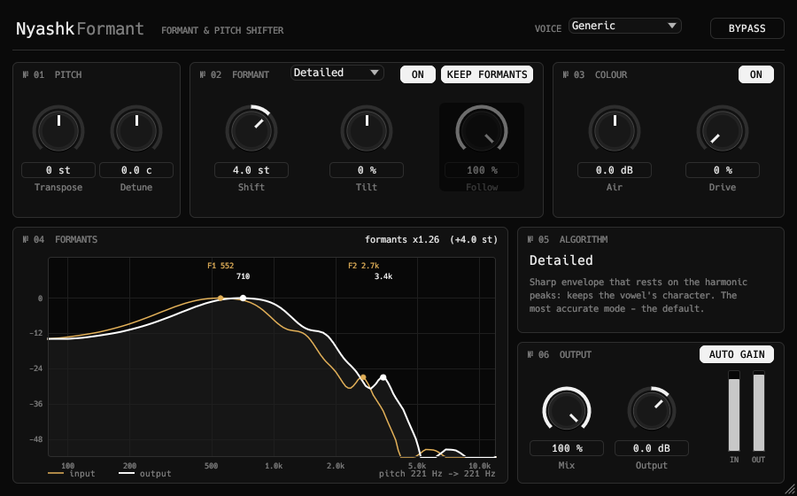

<div align="center">

# NyashkFormant

NyashkFormant is a real-time vocal formant and pitch shifter VST3 plugin.

[](https://github.com/xslimakx/NyashkFormant/actions/workflows/build.yml)
[](LICENSE)


[**Download**](https://github.com/xslimakx/NyashkFormant/releases/latest)

</div>

---

## 🗣️ NyashkFormant — formant and pitch shifter

Move the formants of a voice (a smaller or bigger vocal tract: brighter / younger or darker / bigger) without touching its pitch, transpose the pitch while keeping the voice's own timbre, or let the formants follow the pitch like a plain pitch shifter. The formant controls of NyashkTune 1.x, now as their own plugin.

<p align="center"></p>

### Controls

| | |
|---|---|
| **Pitch** | **Transpose** ±12 semitones, **Detune** ±100 cents. |
| **Formant** | **Shift** ±12 semitones (+ smaller, brighter vocal tract, − bigger, darker). **Tilt** moves the high formants more (+) or the low ones more (−). **KEEP FORMANTS** on: Transpose moves only the pitch; off: the formants follow the pitch by **Follow** %. **ON** switches formant processing off. |
| **Algorithm** | **Classic** (grain resampling, the old-school PSOLA sound), **Smooth** (broad envelope, forgiving), **Detailed** (sharp "true envelope", the most accurate, default), **Vocal (LPC)** (all-pole vocal-tract model, peaky character), **Bend** (non-linear warp around 400 Hz). |
| **Colour** | **Air** (high shelf above 7 kHz) and **Drive** (soft saturation) on the processed voice. |
| **Output** | **Mix**, **Output** level and **AUTO GAIN**: keeps the processed voice as loud as the input (a pitch or formant shift changes how loud a voice sounds - up to −13 dB for a high voice an octave up). IN / OUT meters. |
| **Formants view** | The live spectral envelope of the input (amber) and of the output (white) with the formant peaks marked, the formant factor and the pitch before / after. |
| **Voice** | Generic, Bass, Baritone, Tenor, Alto, Soprano: how low / high the pitch detector looks. |

With everything at zero the plugin passes the (delayed) input bit-exact.

### How it works

```
input → YIN pitch detection → pitch marks (one per period)
      → PSOLA grains (two periods, Hann) laid out at the new pitch
      → formants: every ~6 ms the spectral envelope is taken from ~3 periods of the input
        ("true envelope": cepstral smoothing iterated onto the harmonic peaks; LPC fits an
        all-pole model to it), and every grain is filtered by E(f / s) / E(f) - the whole
        filtered block is overlap-added, tails included, so nothing is cut off (no clicks)
      → auto gain (wet level follows the input over ~150 ms) → Air / Drive → mix
```

### Latency (since 1.1.0)

The four modern algorithms (Smooth, Detailed, LPC, Bend) now run on a low-latency path:

| Setting | Latency at 48 kHz |
|---|---|
| Formant shift only (Transpose / Detune at 0) | **≈ 10.7 ms** (one ~10 ms analysis frame) |
| Formants off, no transpose | **0 ms** |
| With Transpose / Detune | ≈ 20–38 ms (10.7 ms + pitch stage, set by the voice range: Soprano shortest, Bass / Generic longest) |
| Classic (PSOLA) | 13–40 ms, as before |

The formant stage is a short STFT (≈ 10 ms Hann frames, 75 % overlap) that applies E(f / s) / E(f) per frame, with the envelope taken from ~3 periods of the voice. Transpose uses a resampling read head inside a short delay line that jumps by whole periods at the best-matching point (crossfaded), and the formant envelope is read from the original voice so Transpose keeps the formants. The latency is reported to the host and updated when you switch the path; turning Transpose back to 0 drops the pitch stage after 0.5 s.

### Tested

`cargo test -p nyashkformant` checks on synthetic vowels at low and high pitch: every algorithm moves the spectral envelope by the asked amount (±25 %, LPC ±50 %) while the pitch stays within 1 %; Transpose keeps the formants; Auto Gain keeps the level within 1.5 dB for −7 / +7 / +12 st transposes and ±6 st formant shifts; no clicks in any mode, at ±12 st with full Tilt, or while every knob is automated; the same at 44.1 and 96 kHz; neutral settings are transparent; plus fuzzing of the engine.

---

## Installation

Download the archive for your OS from [Releases](https://github.com/xslimakx/NyashkFormant/releases/latest), unzip it and copy `NyashkFormant.vst3` into your VST3 folder:

| OS | Path |
|---|---|
| Linux | `~/.vst3/` or `/usr/lib/vst3/` |
| Windows | `C:\Program Files\Common Files\VST3\` |
| macOS | `~/Library/Audio/Plug-Ins/VST3/` |

## Building from source

Needs [Rust](https://rustup.rs/) (stable). Linux: `libasound2-dev libgl-dev libx11-xcb-dev libxcb1-dev libxcb-icccm4-dev libxcursor-dev libxkbcommon-dev libxcb-dri2-0-dev`.

```bash
git clone https://github.com/xslimakx/NyashkFormant.git
cd NyashkFormant
cargo xtask bundle -p nyashkformant --release   # -> target/bundled/NyashkFormant.vst3
cargo run --release -p nyashkformant --features standalone   # standalone test app
```

## License

[MIT](LICENSE). Note: compiled `.vst3` builds link GPLv3 `vst3-sys` bindings (via NIH-plug), so GPLv3 terms apply when you distribute compiled binaries. Crates in `vendor/` keep their own licenses.

Part of the Nyashk plugins family: [NyashkTune](https://github.com/xslimakx/NyashkTune) · [NyashkKey](https://github.com/xslimakx/NyashkKey) · [NyashkOpto](https://github.com/xslimakx/NyashkOpto) · [NyashkSynth](https://github.com/xslimakx/NyashkSynth)
